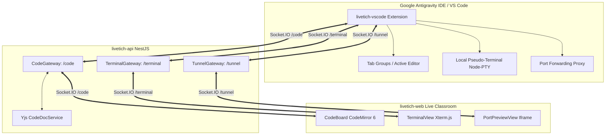

# Livetich Live Collaboration Hand-off Briefing for Codex

This document provides a comprehensive handover of the current system architecture, branch states, completed features, known issues, and immediate next steps.

---

## 1. Repositories & Branch Overview

| Repository | Current Git Branch | Remote URL | Latest Commit & Status |
| :--- | :--- | :--- | :--- |
| **`livetich-api`** | `feat/live-share-terminal-proxy` | `https://github.com/Adenekan123/livetich-api.git` | `44dbd3b` — **Committed & Pushed to Origin** |
| **`livetich-web`** | `feat/live-share-terminal-proxy` | `https://github.com/Adenekan123/livetich-web.git` | `9cee669` — **Committed & Pushed to Origin** |
| **`livetich-vscode`** | `feat/live-share-terminal-proxy` | *(Local repository)* | `8da5ad1` — **Committed locally** |

> [!NOTE]
> All pending changes across all three repositories have been committed cleanly, and remote tracking branches have been pushed to GitHub for both `livetich-api` and `livetich-web`.

---

## 2. System Architecture: The Duckly-Like Collaboration Triad

Livetich live collaboration connects three execution surfaces:



1. **Local IDE (Google Antigravity IDE / VS Code)**:
   - Extension: `livetich-vscode`.
   - Connects to `livetich-api` via Socket.IO `/code`, `/terminal`, and `/tunnel`.
   - Seeds document buffers, streams cursor/mouse movement, streams workspace explorer tree state, streams bash/zsh/powershell terminals, and forwards localhost ports.
2. **Backend Gateway (`livetich-api`)**:
   - NestJS WebSocket Gateways on namespaces `/code` (`src/code/code.gateway.ts`), `/terminal` (`src/terminal/terminal.gateway.ts`), and `/tunnel` (`src/tunnel/tunnel.gateway.ts`).
   - In-memory document retention with Yjs binary update propagation (`code-doc.service.ts`).
3. **Web Live Classroom (`livetich-web`)**:
   - Next.js application with CodeMirror 6 studio (`src/app/sessions/[id]/code-board.tsx`).
   - Features remote floating pointer gliding, spotlight laser, terminal xterm.js tab, live web preview iframe, and multi-file tab bar.

---

## 3. What Has Been Completed & Polished

### A. Real-Time Tab Closing Between Web Editor and Local IDE
* **Web UI (`src/app/sessions/[id]/code-board.tsx`)**:
  - Removed single-tab restrictions (`openFiles.length > 1`) so closing any tab (even the final tab) is always possible.
  - Added dedicated close icon button (`<PiX size={12} />`) with `e.stopPropagation()` and `e.preventDefault()`.
  - Added empty state (`"No editor open"`) when all tabs are closed.
  - Dispatches both `code:tab-close` (`{ sessionId, path, nextActive, all }`) and `code:focus` with updated `openFiles`.
  - Removed `isWritable` requirement on `closeFileTab` so tab closing events are unconditionally sent when connected.
* **API Gateway (`src/code/code.gateway.ts`)**:
  - Added `@SubscribeMessage('code:tab-close')` and broadcasts it to the session room.
  - Updated contract interfaces in `src/shared/index.ts`.
* **Local Extension (`src/liveshare/code-sync.ts`)**:
  - `closeLocalTab(targetPath)`: Dual-layer tab closure. If the active editor matches, it triggers `workbench.action.closeActiveEditor`; it also scans `vscode.window.tabGroups.all` and closes matching background tabs.
  - `closeAllLocalTabs()`: Invokes native `workbench.action.closeAllEditors`.
  - `activateLocalTab(nextActive)`: Automatically focuses the adjacent document in the local IDE.
  - `matchesPath`: Made case-insensitive with basename fallback matching (handles Windows OneDrive and multi-root path prefix variances).
  - Wrapped tab listeners with an `isClosingRemoteTab` guard to eliminate echo loops.

### B. Single Click Bubble & Debounced Ripple Aesthetics
* **Eliminated Double Bubble**: Previously, mouse clicks in the editor triggered duplicate events from both `code:pointer` (`isClick: true`) and `code:focus`. `code:focus` was updated to purely sync state without firing click animations.
* **Debounce Guard**: Added a 220ms + 18px spatial debounce in `triggerEditorRipple` inside `code-board.tsx`.
* **Soft Glassy Styling**: Replaced the harsh 3-ring concentric shockwave with a single translucent emerald ripple (`editor-click-bubble`) and micro-dot (`editor-click-center`).

### C. Live Mouse Pointer Tracking
* Registered a real-time hover provider (`src/liveshare/code-sync.ts:203-221`) streaming cursor movements at 60fps to the web editor layer.

### D. File Tree & Explorer Sync
* Automated synchronization of IDE folder expand/collapse state by monitoring VS Code's `state.vscdb` storage SQLite DB.

### E. Co-Edit Permissions
* Implemented permissions menu with **Instructor Only**, **Delegated Student (1-to-1)**, and **Open to Entire Class**.

---

## 4. Critical Technical Gotcha: Extension Runtime Directory

> [!WARNING]
> **Pay close attention to this when testing `livetich-vscode` in Antigravity IDE:**

* Antigravity IDE and VS Code execute the extension from:
  ```
  C:\Users\User\.vscode\extensions\usmanadenekan.livetich-0.1.4\out\extension.js
  ```
* Standard `tsc` outputs to `c:\Users\User\OneDrive\Documents\netplus\livetich-vscode\out\extension.js`.
* **Fix Applied**: Updated `package.json` in `livetich-vscode` so `npm run compile` automatically copies the bundled `out/*` files directly into `~/.vscode/extensions/usmanadenekan.livetich-0.1.4/out/`.
* **Extension Host Caching**: Because VS Code / Antigravity IDE caches extension bundles in memory, whenever you recompile the extension, you must run:
  > **`Ctrl+Shift+P`** (or **`F1`**) → **`Developer: Reload Window`**
  for the running editor to pick up the updated JavaScript.

---

## 5. Development Services & Ports

* **`livetich-web`**: Running on `http://localhost:3000` (`pnpm run dev`).
* **`livetich-api`**: Running on `http://localhost:3005` (`pnpm run start:dev`).
* **Local Database**: MySQL on port `3306` (`livetich_dev`).
* **Redis**: Port `6379`.
* **Deep links**:
  - `antigravity://UsmanAdenekan.livetich/join?sessionId=<id>`
  - `vscode://UsmanAdenekan.livetich/join?sessionId=<id>`

---

## 6. Priority Tasks for Codex

1. **Verify Tab Closing**: Open multiple files locally (e.g., `.prettierrc`, `.env.example`, `code-sync.ts`), connect to the live session, and verify closing tabs on the web editor immediately closes the corresponding local tab.
2. **Verify Free Roam & Jump-To**: Confirm student "Free Roam" mode allows students to open other tabs without desyncing the instructor's live tabs.
3. **Inspect Output Channel**: If any tab fails to close, check the `livetich` logs in the extension output channel (`[livetich] Remote tab close event received:`).
